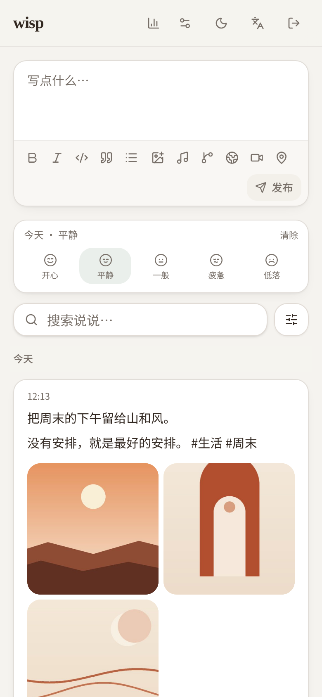
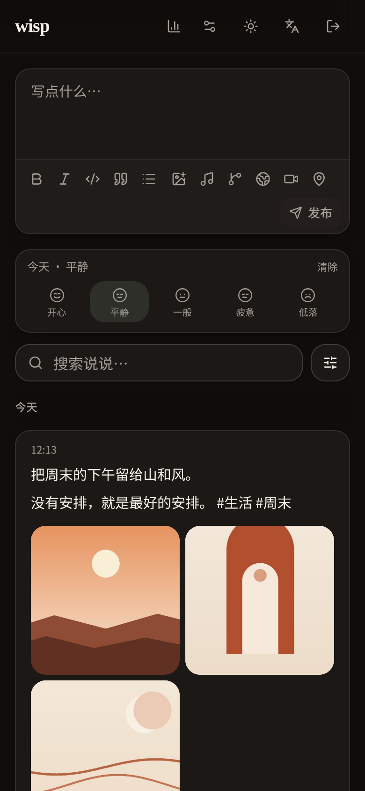
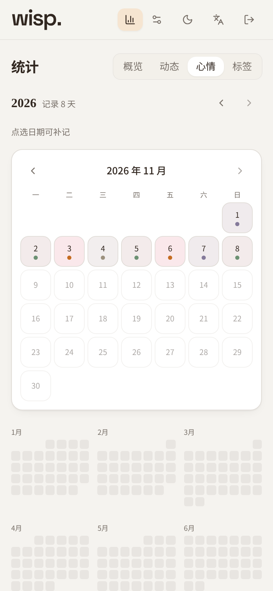
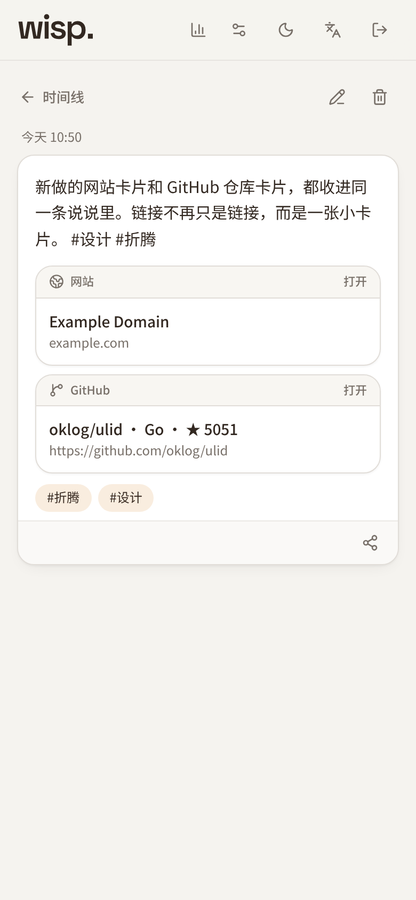

<div align="center">

<picture>
  <source media="(prefers-color-scheme: dark)" srcset="docs/assets/wordmark-white.svg">
  
</picture>

**记录生活中的小确幸。**

自托管的轻量「说说 / 朋友圈」。3 秒发布、每日心情、图片与卡片、PWA 离线；数据留在自己的服务器。

[](https://github.com/lmb666666/wisp/actions/workflows/ci.yml)
[](https://github.com/lmb666666/wisp/releases)
[](LICENSE)
[](go.mod)
[](web/package.json)
[](https://github.com/lmb666666/wisp/stargazers)

[快速开始](#快速开始) · [部署](docs/DEPLOY.md) · [API](docs/API.md) · [迁移](docs/MIGRATION.md) · [更新日志](CHANGELOG.md) · [Releases](https://github.com/lmb666666/wisp/releases)

</div>

<p align="center">
  
</p>

## 截图

<table width="100%">
  <tr>
    <td align="center"><br>时间线 · 浅色</td>
    <td align="center"><br>时间线 · 深色</td>
  </tr>
  <tr>
    <td align="center"><br>每日心情 · 月度补记与年度概览</td>
    <td align="center"><br>扩展卡片</td>
  </tr>
</table>

## 为什么是 Wisp

- **轻记录。** 移动端优先，服务端渲染 Markdown；草稿留在浏览器，离线也能写完，联网后自动补发。
- **每日心情。** 一天一条 5 档心情，首页一键记录；日期头、月度补记和年度概览帮你回看情绪。
- **数据自持。** SQLite 单文件 + 本地媒体目录；内容包（含原图、卡片与心情）可导出，定时快照和媒体清理内置。
- **单二进制。** 前端通过 `go:embed` 打进 Go 服务，部署不需要 Node、反向代理也能先跑起来。
- **开放。** REST API、作用域 PAT、OpenAPI、RSS、Webhook 和官方 CLI 都是一等能力。

## 功能

- **写作与浏览**：Markdown 编辑器（TipTap）、粘贴 / 拖拽图片自动压缩、草稿与离线队列、PWA 分享直达发布、时间线按日分组、图片九宫格、blurhash、lightbox、标签聚合、全文搜索、日期 × 多标签筛选、浅色 / 深色、中英文与 Passkey。
- **每日心情**：固定 5 档（开心 / 平静 / 一般 / 疲惫 / 低落），首页心情条、日期头展示、访客可见的带日期「最近心情」、统计页月度补记与年度概览。
- **媒体与卡片**：图片 / 视频 / 音频附件、服务端缩略图与视频封面、SHA256 秒传；本地 / S3 兼容 / Lsky Pro 存储与本地镜像；音乐、GitHub、网站、视频、位置卡片，视频与地图点击后才加载。
- **整理与运维**：标签重命名 / 合并 / 删除、媒体库筛选与清理、Wisp Capsule 导出 / 导入、自动数据库备份、站点概览、Webhook；迁移前自动快照，支持从 Memos / Moments / Ech0 / Wisp 导入。
- **开放能力**：完整 REST API、`read` / `read,write` 作用域 PAT、OpenAPI 与 Swagger UI、RSS 2.0、官方 `wisp-cli`。

## 快速开始

### Docker Compose（推荐）

```bash
git clone https://github.com/lmb666666/wisp.git
cd wisp

# 由宿主用户创建数据目录，避免 Docker 以 root 创建后容器写不进去
mkdir -p data

# 生产环境务必改成实际访问地址
WISP_UID="$(id -u)" WISP_GID="$(id -g)" \
WISP_PUBLIC_URL=https://wisp.example.com \
docker compose up -d --build
```

打开你设置的 `WISP_PUBLIC_URL`（本地为 `http://localhost:8080`），按首启向导创建站点所有者。数据会持久化在 `./data`。

> 镜像以非 root 运行；compose 默认只读根文件系统、`/tmp` 内存盘、`cap_drop: ALL` 与 `no-new-privileges`。
> 数据目录必须可被容器用户写入，详见 [docs/DEPLOY.md](docs/DEPLOY.md#数据目录权限绑定挂载必读)。
>
> 发布后也可以直接使用镜像：`docker compose pull && docker compose up -d`。

### 二进制

从 [Releases](https://github.com/lmb666666/wisp/releases) 下载对应平台压缩包：

```bash
tar -xzf wisp_0.4.0_linux_amd64.tar.gz
WISP_PUBLIC_URL=https://wisp.example.com ./wisp
```

首次启动会创建 `./data/wisp.db` 并自动执行迁移。升级时替换二进制即可，迁移前会自动在 `data/backups/` 留快照。

### 从源码构建

需要 Go 1.26+、Node.js 22+、pnpm 11+：

```bash
pnpm --dir web install
make build        # 先构建前端，再编译嵌入了 dist 的 ./wisp
./wisp
```

本地开发：

```bash
pnpm --dir web install
make dev          # 同时启动 Go API（:8080）与 Vite（:5173）
```

## 配置

| 变量 | 默认 | 说明 |
|---|---|---|
| `WISP_PORT` | `8080` | HTTP 监听端口 |
| `WISP_PUBLIC_URL` | `http://localhost:8080` | 对外地址；RSS / OG / 分享链接使用，**生产必填** |
| `WISP_DATA_DIR` | `./data` | 数据目录（数据库、媒体、备份） |
| `WISP_DB_PATH` | `<data>/wisp.db` | 自定义数据库路径 |
| `WISP_LOG_LEVEL` | `info` | `debug` / `info` / `warn` / `error` |
| `WISP_ENABLE_SWAGGER` | `false` | 暴露 `/swagger` 与 `/swagger/openapi.yaml` |
| `WISP_API_RATE_LIMIT` | `20` | API 限流（每秒 / IP） |
| `WISP_AUTH_RATE_LIMIT` | `1` | 登录/首启限流（每秒 / IP；Argon2 内存开销高） |
| `WISP_READ_TIMEOUT` | `10m` | 整个请求（含上传 body）的读取上限 |
| `WISP_WRITE_TIMEOUT` | `5m` | 响应写入上限 |
| `WISP_CORS_ORIGINS` | （空） | 允许跨域调用 API 的来源，逗号分隔 |
| `WISP_TRUST_PROXIES` | `false` | 置 `true` 时从 `X-Forwarded-For` 取客户端 IP（限流用），仅在可信反向代理后开启 |
| `WISP_METING_API` | （空） | Meting 音乐解析端点；留空时不提供播放器 |
| `WISP_GEOCODE_URL` | （空） | Nominatim 兼容端点；留空时位置卡只支持定位/手填 |

完整说明见 [docs/DEPLOY.md](docs/DEPLOY.md)。

## API 与 CLI

在「设置 → API 令牌」创建 PAT，`read` 只读，`read,write` 可写：

```bash
curl -X POST https://wisp.example.com/api/v1/posts \
  -H "Authorization: Bearer wpat_xxx" \
  -H "Content-Type: application/json" \
  -d '{"content_md":"今天也在好好生活。 #日记","visibility":"public"}'

curl -X PUT https://wisp.example.com/api/v1/moods/2026-11-08 \
  -H "Authorization: Bearer wpat_xxx" \
  -H "Content-Type: application/json" \
  -d '{"mood":"calm"}'
```

- 时间线 / 搜索 / 标签 / 心情 / 统计 / RSS：公开读取
- 发帖 / 编辑 / 删除 / 心情写入：会话或 `read,write` PAT
- 导入 / 备份 / 媒体库 / 站点设置：仅会话（Web 管理端）
- OpenAPI：`/swagger/openapi.yaml`（开启 Swagger 后）

CLI 同样使用 PAT：

```bash
wisp-cli -url https://wisp.example.com -token wpat_xxx post "一条新说说 #wisp"
wisp-cli -url https://wisp.example.com -token wpat_xxx list -n 5
```

## 数据与迁移

- **整站备份**：设置 → 数据 → 自动备份 / 下载快照
- **可携带归档**：设置 → 数据 → 导出内容包（Markdown + 原图 + 卡片 + 心情）
- **从旧应用迁移**：设置 → 数据 → 导入旧数据，支持 Memos、Moments、Ech0 与 Wisp capsule

迁移来源、内容包格式与限制见 [docs/MIGRATION.md](docs/MIGRATION.md)。

## 技术栈

| 层 | 选型 |
|---|---|
| 后端 | Go 1.26 · Echo v4 · sqlc · modernc SQLite（WAL + FTS5）· goose |
| 前端 | React 19 · TypeScript · Vite · Tailwind CSS v4 · shadcn/ui · TanStack Query/Router · TipTap |
| 交付 | `go:embed` 单二进制 · distroless Docker · goreleaser · GitHub Actions |

## 测试

```bash
go test ./...
go test -tags load -run TestLoad10k ./internal/load/   # 万帖压测
pnpm --dir web test
pnpm --dir web typecheck
pnpm --dir web lint
pnpm --dir web exec playwright test                    # 需要已初始化实例；Swagger 用例需 WISP_ENABLE_SWAGGER=true
python3 scripts/full_matrix.py                         # 全功能验收矩阵（默认 :18200 空库实例）
```

> 本地跑 E2E / 矩阵时建议给测试实例设置 `WISP_AUTH_RATE_LIMIT=1000`，
> 避免连续登录被默认的登录限流拦截。

## 文档

| 文档 | 内容 |
|---|---|
| [docs/DEPLOY.md](docs/DEPLOY.md) | 部署、反向代理、权限、备份恢复 |
| [docs/API.md](docs/API.md) | REST API、PAT、分页、心情与 Webhook |
| [docs/MIGRATION.md](docs/MIGRATION.md) | 从 Memos / Moments / Ech0 / Wisp 迁移；内容包格式与限制 |
| [CONTRIBUTING.md](CONTRIBUTING.md) | 开发环境、代码结构、测试与提交约定 |
| [SECURITY.md](SECURITY.md) | 安全策略与私下报告方式 |
| [CHANGELOG.md](CHANGELOG.md) | 版本记录 |

## 参与贡献

欢迎 Issue、文档修正和代码贡献。开始前请读 [CONTRIBUTING.md](CONTRIBUTING.md)；提交代码即表示同意以 MIT 许可证发布。

Wisp 面向**单作者**场景：没有多用户、角色权限、评论或联邦。请不要把它当作多人社区平台使用。

## 安全

发现安全问题请通过 GitHub 的 **Security → Advisories** 私下报告，不要开公开 Issue。细节见 [SECURITY.md](SECURITY.md)。

## 许可证

[MIT](LICENSE) © 2026 Liang
