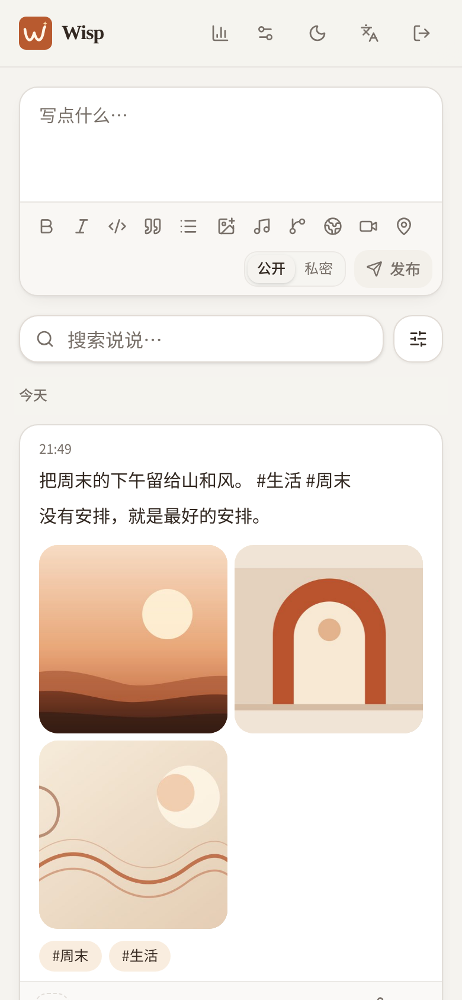
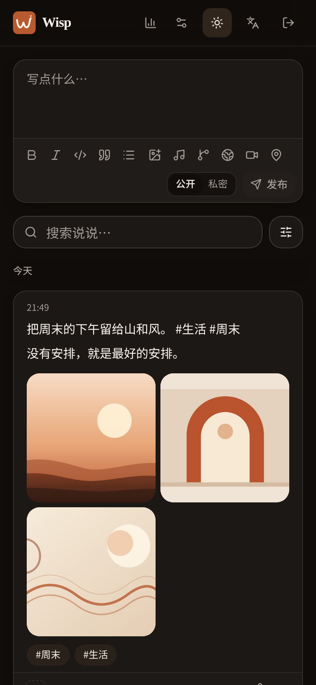
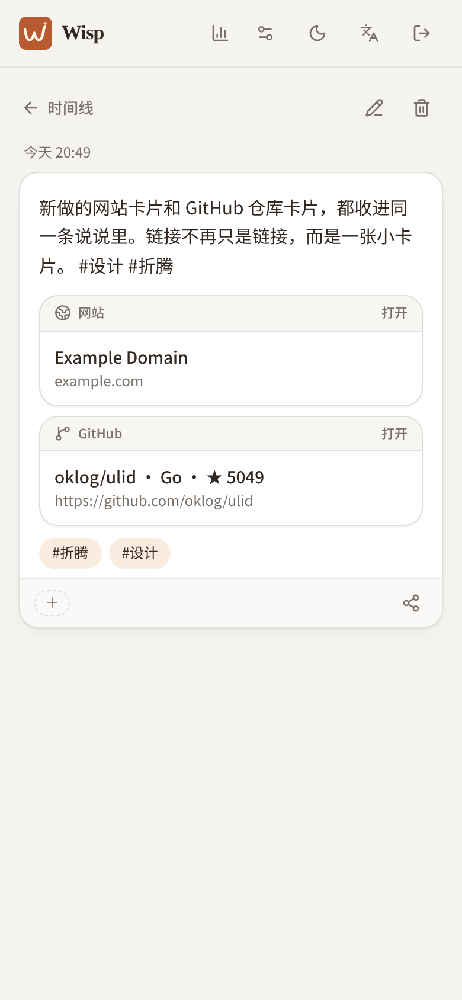

<p align="center">
  
</p>

<p align="center">
  <a href="https://github.com/lmb666666/wisp/actions/workflows/ci.yml"></a>
  
  <a href="LICENSE"></a>
  
  
</p>

<h3 align="center">把自己的「说说」放回自己的服务器。</h3>

<p align="center">
  <strong>3 秒发布</strong> · 单二进制 · 一个 data 目录 · PWA 离线 · API-first · MIT
</p>

Wisp 是一款单作者、自托管的轻量「说说 / 朋友圈」。没有推荐算法，没有评论区，也没有把数据交给平台的理由。打开网页或安装成 PWA，像发朋友圈一样记录一条想法；图片、音乐、GitHub 仓库、网站和位置会收成干净的卡片，所有内容都留在你自己的服务器上。

<p align="center">
  
  
  
</p>

## 为什么是 Wisp

- **像发朋友圈一样轻。** 移动端优先，服务端渲染 Markdown；草稿自动留在浏览器，离线也能写完，联网后自动补发。
- **数据真的属于你。** SQLite 单文件 + 本地媒体目录；内置内容包导出、定时数据库快照和媒体库清理。
- **一个二进制就够。** 前端通过 `go:embed` 打进 Go 服务，部署不需要 Node、反向代理也能先跑起来。
- **少即是多。** 单作者、无评论、无多用户、无联邦。把「记录」这件事做好，而不是把设置页塞满。
- **对开发者友好。** REST API、作用域 PAT、OpenAPI、RSS、Webhook 和官方 CLI 都是一等能力。

## 功能

**写作与浏览**
- Markdown 编辑器（TipTap），粘贴 / 拖拽图片自动压缩上传
- 公开 / 私密两种可见性；草稿、离线队列、PWA 分享菜单直达发布
- 时间线按日分组、图片九宫格、blurhash 占位、lightbox
- 点赞、标签聚合、全文搜索、日期 × 可见性 × 多标签组合筛选
- 浅色 / 深色主题，中英文界面，Passkey 登录

**媒体与扩展卡片**
- 图片 / 视频 / 音频附件；服务端缩略图、视频封面、SHA256 秒传
- 存储驱动：本地 / S3 兼容 / Lsky Pro，可开启本地镜像
- 音乐、GitHub、网站、视频、位置卡片；视频与地图点击后才加载，尊重隐私
- 位置卡支持坐标、Nominatim 搜索 / 反查（可选）与 OSM 地图

**整理与运维**
- 标签重命名、合并、删除；媒体库筛选、占用统计、无主文件清理
- 内容包（Wisp Capsule）导出 / 导入，带原图与扩展卡片
- 自动数据库备份（默认每日一份、保留 7 份）、站点概览、Webhook 通知
- 迁移前自动快照；从 Memos / Moments / Ech0 / Wisp 导入

**开放能力**
- `GET /api/v1/posts` 等完整 REST API；read / write 作用域 PAT
- OpenAPI 描述与 Swagger UI（`WISP_ENABLE_SWAGGER=true`）
- RSS 2.0 全量与按标签订阅；官方 `wisp-cli` 随 release 分发

## 快速开始

### Docker Compose（推荐）

```bash
git clone https://github.com/lmb666666/wisp.git
cd wisp

# 生产环境务必改成实际访问地址
WISP_PUBLIC_URL=https://wisp.example.com docker compose up -d --build
```

打开你设置的 `WISP_PUBLIC_URL`（本地为 `http://localhost:8080`），按首启向导创建站点所有者。数据会持久化在 `./data`。

> 发布后也可以直接使用镜像：`docker compose pull && docker compose up -d`。
> 更多反向代理、权限、恢复说明见 [docs/DEPLOY.md](docs/DEPLOY.md)。

### 二进制

从 [Releases](https://github.com/lmb666666/wisp/releases) 下载对应平台压缩包：

```bash
tar -xzf wisp_0.2.0_linux_amd64.tar.gz
WISP_PUBLIC_URL=https://wisp.example.com ./wisp
```

首次启动会创建 `./data/wisp.db` 并自动执行迁移。升级时替换二进制即可，迁移前会自动在 `data/backups/` 留快照。

### 从源码构建

需要 Go 1.26+、Node.js 22+、pnpm 11+：

```bash
pnpm --dir web install
make build        # 先构建前端，再编译嵌入了 dist 的 ./wisp
./wisp
```

本地开发：

```bash
pnpm --dir web install
make dev          # 同时启动 Go API（:8080）与 Vite（:5173）
```

## 配置

| 变量 | 默认 | 说明 |
|---|---|---|
| `WISP_PORT` | `8080` | HTTP 监听端口 |
| `WISP_PUBLIC_URL` | `http://localhost:8080` | 对外地址；RSS / OG / 分享链接使用，**生产必填** |
| `WISP_DATA_DIR` | `./data` | 数据目录（数据库、媒体、备份） |
| `WISP_DB_PATH` | `<data>/wisp.db` | 自定义数据库路径 |
| `WISP_LOG_LEVEL` | `info` | `debug` / `info` / `warn` / `error` |
| `WISP_ENABLE_SWAGGER` | `false` | 暴露 `/swagger` 与 `/swagger/openapi.yaml` |
| `WISP_API_RATE_LIMIT` | `20` | API 限流（每秒 / IP） |
| `WISP_CORS_ORIGINS` | （空） | 允许跨域调用 API 的来源，逗号分隔 |
| `WISP_METING_API` | （空） | Meting 音乐解析端点；留空时不提供播放器 |
| `WISP_GEOCODE_URL` | （空） | Nominatim 兼容端点；留空时位置卡只支持定位/手填 |

完整说明见 [docs/DEPLOY.md](docs/DEPLOY.md)。

## API 与 CLI

在「设置 → API 令牌」创建 PAT，`read` 只读，`read,write` 可写：

```bash
curl -X POST https://wisp.example.com/api/v1/posts \
  -H "Authorization: Bearer wpat_xxx" \
  -H "Content-Type: application/json" \
  -d '{"content_md":"今天也在好好生活。 #日记","visibility":"public"}'
```

- 时间线 / 搜索 / 标签 / 统计 / RSS：公开读取
- 发帖 / 编辑 / 删除：会话或 `read,write` PAT
- 导入 / 备份 / 媒体库 / 站点设置：仅会话（Web 管理端）
- OpenAPI：`/swagger/openapi.yaml`（开启 Swagger 后）

CLI 同样使用 PAT：

```bash
wisp-cli -url https://wisp.example.com -token wpat_xxx post "一条新说说 #wisp"
wisp-cli -url https://wisp.example.com -token wpat_xxx list -n 5
```

## 数据与迁移

- **整站备份**：设置 → 数据 → 自动备份 / 下载快照
- **可携带归档**：设置 → 数据 → 导出内容包（Markdown + 原图 + 卡片）
- **从旧应用迁移**：设置 → 数据 → 导入旧数据，支持 Memos、Moments、Ech0 与 Wisp capsule

格式与限制见 [docs/CAPSULE.md](docs/CAPSULE.md)，迁移细节见 [docs/MIGRATION.md](docs/MIGRATION.md)。

## 技术栈

| 层 | 选型 |
|---|---|
| 后端 | Go 1.26 · Echo v4 · sqlc · modernc SQLite（WAL + FTS5）· goose |
| 前端 | React 19 · TypeScript · Vite · Tailwind CSS v4 · shadcn/ui · TanStack Query/Router · TipTap |
| 交付 | `go:embed` 单二进制 · distroless Docker · goreleaser · GitHub Actions |

## 测试

```bash
go test ./...
go test -tags load -run TestLoad10k ./internal/load/   # 万帖压测
pnpm --dir web test
pnpm --dir web typecheck
pnpm --dir web lint
pnpm --dir web exec playwright test                    # 需要先起一个已初始化的实例
python3 scripts/full_matrix.py                         # 全功能验收矩阵
```

## 文档

| 文档 | 内容 |
|---|---|
| [docs/DEPLOY.md](docs/DEPLOY.md) | 部署、反向代理、备份恢复、权限 |
| [docs/API.md](docs/API.md) | REST API、PAT、分页与示例 |
| [docs/CAPSULE.md](docs/CAPSULE.md) | 内容包格式与导入导出 |
| [docs/MIGRATION.md](docs/MIGRATION.md) | 从 Memos / Moments / Ech0 / Wisp 迁移 |
| [docs/ARCHITECTURE.md](docs/ARCHITECTURE.md) | 代码结构与关键设计 |
| [docs/BRAND.md](docs/BRAND.md) | Logo、颜色与素材使用 |
| [CHANGELOG.md](CHANGELOG.md) | 版本记录 |

## 安全

发现安全问题请通过 GitHub 的 **Security → Advisories** 私下报告，不要开公开 Issue。细节见 [SECURITY.md](SECURITY.md)。

Wisp 面向**单作者**场景：没有多用户、角色权限、评论或联邦。请不要把它当作多人社区平台使用。

## 参与贡献

欢迎 Issue、文档修正和代码贡献。开始前请读 [CONTRIBUTING.md](CONTRIBUTING.md)；提交代码即表示同意以 MIT 许可证发布。

## 许可证

[MIT](LICENSE) © 2026 Liang
